# TamaPoke

[](https://dylanpdao.github.io/TamaPoke/web/)
[](https://makerworld.com/es/models/2937822-tamapoke-a-pokemon-pokeball-tamagotchi)


[](https://github.com/DylanPDao/TamaPoke/stargazers)

A Pokémon tamagotchi for the **Waveshare ESP32-S3-Touch-AMOLED-1.75** (round
466×466 AMOLED, CO5300 over QSPI, CST9217 touch over I²C). Hatch an egg, raise
the creature through a real-time life, evolve it, train it, battle the gym
ladders of **nine regions**, catch wild Pokémon, trade and fight friends over
LAN, and try to fill a Pokédex of **1025 slots, shinies included**.

> ### 🙏 This is a fork of [**socquique/TamaPoke**](https://github.com/socquique/TamaPoke) by **Quique Tortosa**
>
> Quique wrote the original TamaPoke: the firmware, the sprite pipeline, the
> six-language UI, the audio bring-up and the web installer. This fork builds on
> that work; it did not start it. If you like this, go
> **[star the original](https://github.com/socquique/TamaPoke)**.
>
> Original: MIT © 2026 Quique Tortosa. Changes in this fork are MIT on the same
> terms.

> **Where this build comes from.** It merges two community forks. The
> **move-based battle engine, LAN battles and trading, the regional ladders, the
> party and box, and the Pokédex expansion to Gen 9** are this fork's own work.
> **Wild encounters and catching** come from
> [ShadowEnemyx/TamaPoke — Expanded](https://github.com/ShadowEnemyx/TamaPoke/tree/tamapoke-expanded-update),
> ported onto this fork's engine so a wild fight is the same fight, with the same
> moves and UI, just without a trainer behind the creature.

> **Personal, non-commercial fan project.** Code is MIT; the sprites are from
> PMD SpriteCollab (CC BY-NC, Pokémon © Nintendo/Game Freak); the 3D case is
> CC BY-NC-SA. See [License](#license) and [`CREDITS.md`](CREDITS.md).

🔴 **3D-printed Pokéball case + print profiles → [MakerWorld](https://makerworld.com/es/models/2937822-tamapoke-a-pokemon-pokeball-tamagotchi)**
· ⚡ **Flash it from your browser → [web installer](https://dylanpdao.github.io/TamaPoke/web/)**

---

## Contents

- [Features](#features)
- [Quick start](#quick-start)
- [Screenshots](#screenshots)
- [How to play](#how-to-play)
- [Game manual](#game-manual)
- [Regions, species and sprites](#regions-species-and-sprites)
- [Hardware](#hardware)
- [Building from source](#building-from-source)
- [Serial console](#serial-console)
- [Project layout](#project-layout)
- [Status and roadmap](#status-and-roadmap)
- [Credits](#credits) · [License](#license)

---

## Features

**Raising**
- A creature that ages in real time (1 real minute = 1 game minute), **+1 level
  per hour**, up to level 100. It keeps aging while the device is off
  (the RTC runs), catching up to two weeks.
- Four needs (food, joy, energy, hygiene), berries with hidden favourites,
  a poop/bath cycle, weight, sleep, a daily **streak** and a per-creature
  **bond**.
- Eggs that roll a **rarity tier**, optional **shinies**, and **IVs** that make
  every hatch unique.
- Evolution you **witness** (it never happens on its own), including Eevee's
  eight branches and cross-generation evolutions.
- Three endings: **farewell** (the good one), **run-away** (the sad one) and
  **release**, plus an early **retire**. Farewells and releases put the creature
  in your **party** or **box**.

**Doing things**
- **Gym ladders for nine regions** — Kanto, Johto, Hoenn, Sinnoh, Unova, Kalos,
  Alola, Galar and Paldea — each with eight leaders, an Elite Four and a
  champion, on **easy and hard**, with badges.
- A **move-based battle engine**: real 18×18 type chart, STAB, ailments, 90
  moves, level-up learnsets and TMs, and an AI on hard mode.
- **Wild encounters and catching**, on a timer or on demand from the menu.
- **LAN battles and trading between two devices** (ESP-NOW).
- Training minigames for **strength, speed and defence**.
- A **Pokédex** of 1025 slots, browsed one region at a time, with shinies tracked
  separately.

**Device**
- Animated **PMD SpriteCollab** sprites streamed from microSD, with biome and
  real-time (dawn/day/dusk/night) backgrounds.
- **Game Boy-style sound** (ES8311 codec) — battle music and effects.
- **6 UI languages**: English (default), Spanish, French, German, Italian,
  Portuguese.
- Battery (AXP2101) and PWR-button handling, anti-burn-in dimming, and a
  full **save backup / restore** over the serial console.
- A one-click **web installer** and a **desktop emulator** that runs the real
  firmware.

---

## Quick start

### 1. Get the hardware

A [Waveshare ESP32-S3-Touch-AMOLED-1.75](https://www.waveshare.com/wiki/ESP32-S3-Touch-AMOLED-1.75),
a **microSD card** (the sprites live on it; ~300 MB for all nine regions) and a
USB-C cable. Optionally, a small speaker on the MX1.25 connector and the
[3D-printed case](https://makerworld.com/es/models/2937822-tamapoke-a-pokemon-pokeball-tamagotchi).
See [Hardware](#hardware) for which board variant to buy.

### 2. Flash it from the browser

Open the **[web installer](https://dylanpdao.github.io/TamaPoke/web/)** in
desktop **Chrome or Edge** (Web Serial is not in Firefox or Safari).

1. **Load TamaPoke** — connect the board over USB and press *Install*. This
   flashes the firmware. Leave **Erase device** unticked when *updating* so you
   keep your creature; tick it for a brand-new board.
2. **Load Sprites** — insert the microSD, close the step-1 dialog (only one
   program can hold the serial port), and press *Load Sprites*. It sends every
   available region pack to `/mons` on the card over USB. This is the slow part
   (Kanto alone is ~40 MB; all nine regions are ~300 MB), so leave the tab open.
   Re-running it is safe.
3. Press the **PWR** button to restart, pick a region and a starter, and play.

> A brand-new board may not show up as a serial port at all. Hold **BOOT**, tap
> **RESET**, release **BOOT**.

A region whose sprite pack is **not** on the card shows as locked (*NEEDS
PACK*) and is kept out of the egg pool, so installing only some regions is a
supported state. A pack sent from the installer unlocks its region as it lands,
with no reboot.

To run the installer yourself (it needs HTTPS or `localhost`), see
[`web/README.md`](web/README.md). On Windows, `web/start-installer.bat` starts a
local no-cache server and opens the page.

### 3. Set the clock

The sleep window and the day/night scenery use the real time. Set it once in
**Menu → SETTINGS** (or with `RTCSET` on the serial console). A board whose clock
was never set simply never auto-sleeps — it fails safe.

---

## Screenshots

Straight off the 466×466 round panel, rendered headlessly by the emulator
(`tools/emu/tamapoke-emu --shot <name>`), so they show exactly what the
hardware draws.

> **These were captured on an earlier build**, when the Pokédex was 386 species
> and three regions. Layouts are current, but counters such as `x/386` and the
> short region lists are out of date.

| Your creature | Its egg | Moves it knows |
|---|---|---|
| 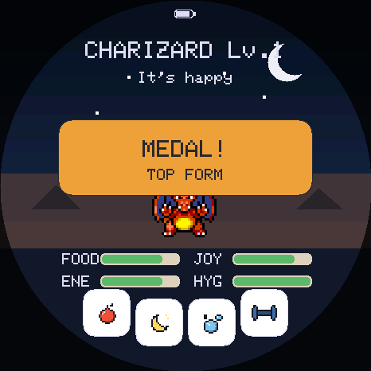 | 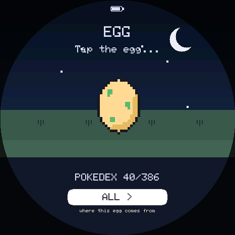 | 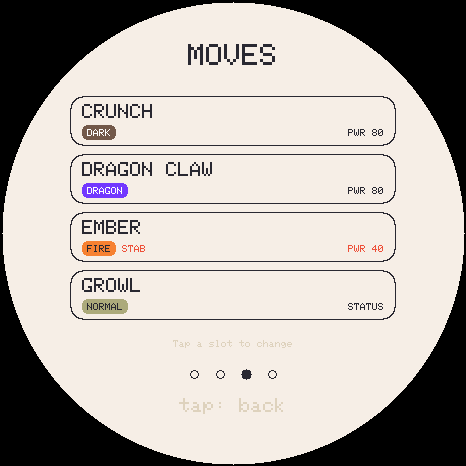 |

| Choosing a team | The fight | Winning a badge |
|---|---|---|
| 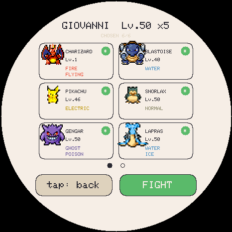 | 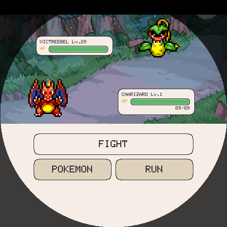 | 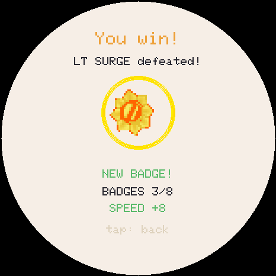 |

| A wild one appears | Catch it? | A gym ladder |
|---|---|---|
| 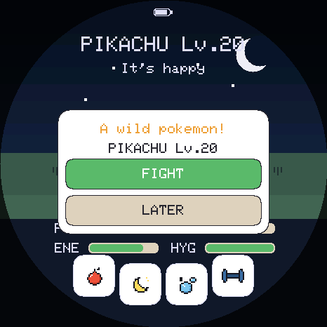 | 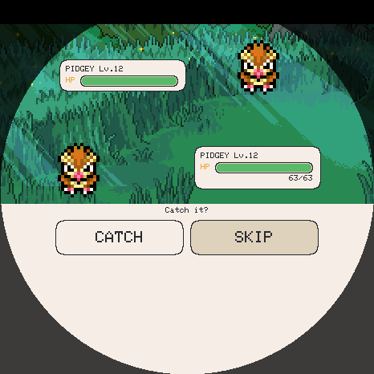 | 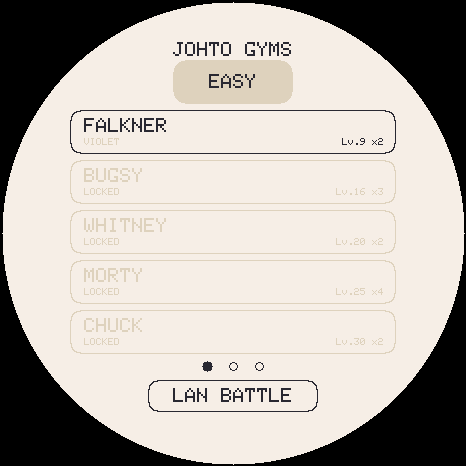 |

| LAN battle | Pokédex gallery | Trainer card | The box |
|---|---|---|---|
| 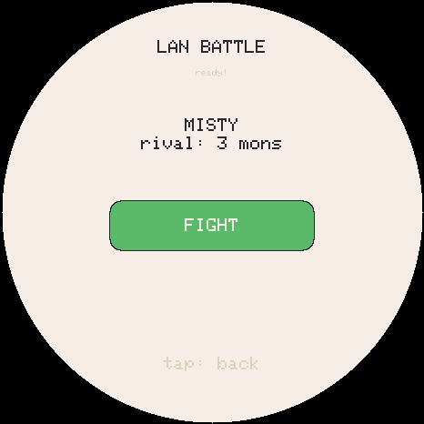 | 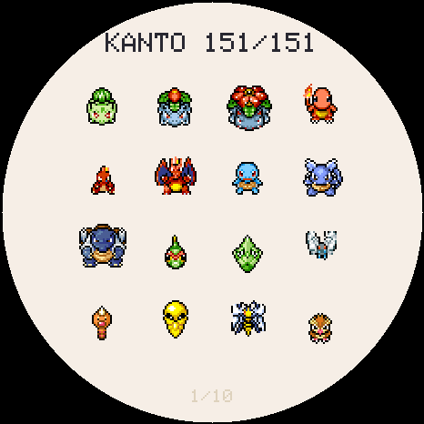 | 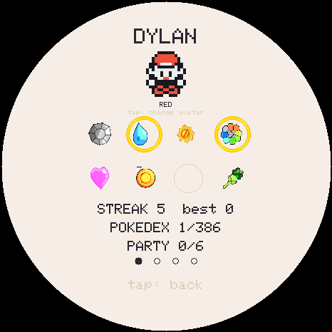 | 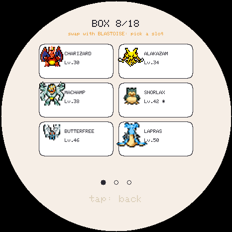 |

---

## How to play

On a new game you **choose a region, then a starter** from that region's
options (Kanto offers five: Bulbasaur, Charmander, Squirtle, Pikachu and Eevee;
every other region offers its three classic starters). The region you pick is
also where your later eggs come from, until you change it on the egg's region
pill. This screen only appears while the Pokédex is empty, so existing saves
never see it.

After that you start with an **egg**. Tap it three times, or just wait three
minutes, and it hatches. From then on you look after it.

### The four buttons (bottom arc)

| Button | What it does |
|---|---|
| 🍎 **Feed** | Food menu: three berries (each species has a hidden favourite that gives a bonus) and a candy (happy, but it fattens). |
| 🌙 **Light** | Send it to bed / wake it. Sleeping recovers energy and slows every other need. |
| 🫧 **Bath** | A foam scene that cleans up the poops and refills hygiene. |
| 🏋️ **Train** | The training menu: **Strength** (punching bag), **Speed** (reaction test), **Defence** (ball game). |

### Touch gestures

| Gesture | From the main screen |
|---|---|
| **Tap the name** at the top | Opens the **menu** (see below). Close it with the CLOSE row, by tapping outside the panel, or with any swipe. |
| **Tap the creature** | Pet it (+joy, +bond). |
| **Swipe up** | The creature's **stat card** — four pages: *Profile*, *Battle*, *Moves*, *Progress*. Swipe sideways between them; tap the name on *Profile* to rename it; tap a move slot on *Moves* to choose a TM. |
| **Swipe down** | The **player card** — your avatar (tap to cycle it) and name (tap to rename), then one **badge page per region**, then your **medals**. |
| **Swipe left** | The **gym ladders** (this is also where **LAN battle** and **Trade** live). |
| **Swipe right** | The **party**. |
| **Hold the creature for 3 s** | The **release** dialog. |

Inside a paged screen (Pokédex, gym ladder, party, box…) **vertical swipes
change region** where the screen has regions, and **horizontal swipes turn
pages**. Swiping past the first page goes back to the region chooser.

### The menu

Tap the name at the top:

| Row | |
|---|---|
| **STATS** | The creature's stat card. |
| **POKEDEX x/N** | The Pokédex gallery, with your count of reachable species. |
| **SETTINGS** | Set the clock, pick the language, sound on/off. |
| **RETIRE** | End the creature early (see [Retiring early](#retiring-a-creature-early)). Greyed out while it is an egg, asleep or in a ceremony. |
| **WILD HUNT** | Start a wild encounter on demand. Greyed out under the same conditions. |
| **CLOSE** | |

### The PWR button

**Short press** = screen on/off. **Long press (4 s)** = full power-off. The RTC
stays alive, so time keeps passing while it is off.

### Decisions: you choose, and you watch

Evolution, farewell and run-away **never fire on their own**. When their
conditions are met a button appears and you tap it, so you are there to see it.

- **Evolution** (red button): *Evolve* — a halo, rays, sparkles and a flicker
  between the old and new form — or *Keep form*, which re-offers at the next
  level.
- **Farewell** (gold button; final form + 3 days): *Say goodbye* (a warm
  farewell, rising hearts, then a new egg) or *Stay together* (re-offered a day
  later). The tension is a maxed-out friend versus completing the Pokédex.
- **Run-away** (dark button; every need at zero for a full hour): a somber
  ending in the rain. Any single act of care cancels it.

---

## Game manual

All numbers below are read from the code.

### Time and levelling

- **1 real minute = 1 game minute.** The creature gains **+1 level per hour** of
  real time. Levelling is purely time-based: caring well does not speed it up,
  but neglect *delays evolution*.
- **Level 100 is reached at 4 days 3 hours.** The farewell is *offered* at
  3 days (level 73) but is **not a deadline** — the creature keeps growing, and
  declining it to reach 100 is a real choice.
- It **keeps aging while powered off**, catching up to a maximum of **2 weeks**.

### The four needs (0–100)

**FOOD**, **JOY**, **ENE** (energy) and **HYG** (hygiene) start at 80 / 80 / 80 /
100. While **awake**, per minute:

| Need | Drain per minute | Notes |
|---|---|---|
| FOOD | −2 | |
| ENE | −1 | −1 extra if overweight (weight > 50) |
| HYG | −1 | **−4 more per poop** on screen (max 3) |
| JOY | −1 | −2 extra if FOOD < 30, −2 extra if HYG < 30 |

- About a **15 % chance per minute** to poop (only while FOOD > 40).
- Weight slowly burns off by itself (about 1 point every 3 minutes).
- A **care slip-up** is letting any need reach **≤ 10** (60-minute cooldown, so
  it counts once). Each slip-up **delays evolution by one level** and cools the
  bond by one.

### Actions

| Action | Effect |
|---|---|
| 🍎 **Berry** | +25 FOOD. If it is the species' **hidden favourite**: +35 FOOD, +10 JOY, hearts, bond, and the favourite is revealed on the card. |
| 🍬 **Candy** | +10 FOOD, +12 JOY, but **+12 weight**. |
| 🫧 **Bath** | Clears all poops, HYG → 100, +1 bond. |
| 👆 **Pet it** | +5 JOY, +1 bond. |
| 🥊 **Training bag** | Trains **STRENGTH** (~4 hits = 1 point, up to +18 per session) and tires it. |
| 🎯 **Reaction test** | A target appears; tap it before it shrinks away. Trains **SPEED**; the window tightens as you go. |
| ⚽ **Ball game** | Trains **DEFENCE** (up to +18 per session), and gives **+5 JOY plus 2 per rally** (max +35). Costs energy and burns weight. Leaving early keeps what you earned. |
| 🌙 **Sleep** | Energy **+6/min**; FOOD, JOY and HYG drain about **4× slower** and stop at floors (FOOD 30 / JOY 35 / HYG 45). No poops, no slip-ups, and it cannot run away while asleep. |

**Automatic sleep.** With the **screen off between 00:00 and 06:00**, the
creature goes to sleep, and it stays asleep until *you* turn the screen back on —
it wakes when you do, not at a fixed hour. It is re-checked every minute, so a
device put down at 23:00 nods off when midnight comes. The Light button always
beats the clock: a creature you sent to bed stays there. The evening is
deliberately outside the window, so the creature can still get hungry while you
are around, but a night's sleep never costs you the creature — it wakes hungry
and grubby, not gone.

### Eggs and who you get

- Hatch an egg by tapping it **3×**, or wait **3 minutes**.
- The **first ever** pet is a starter you choose (see
  [How to play](#how-to-play)).
- Every later egg rolls a **rarity tier**:

| Tier | Base chance | After a proper goodbye | In the egg pool |
|---|---|---|---|
| ✨ Legendary | 3 % \* | 10 % \* | ~87 species |
| 🔵 Rare | 27 % | 45 % | ~139 species |
| ⚪ Common | the rest | the rest | ~312 species |

  \* Legendaries only start appearing once you have **registered ≥ 25** species.
  The pool counts exclude species with no sprite art. All figures are
  approximate: roughly 540 species can hatch from an egg, and every other species
  is evolution-only.

- A high daily **streak** and **bond** raise the rare/legendary odds.
- A clean **goodbye blesses** the next egg. A **run-away curses** it (forced
  Common). A **release** or an **early retire** is neutral.
- Within a tier the roll favours species whose **evolution line you have not
  finished**, so the Pokédex stays completable.
- **Shiny:** base **1 / 48**, **1 / 24** right after a goodbye, improved by
  streak and bond down to a best of **1 / 8**. Shinies are tracked separately.
- Every hatch rolls unique **IVs** (below).

**Choosing your egg's region.** The egg carries a **region pill** — Kanto, Johto,
Hoenn, Sinnoh, Unova, Kalos, Alola, Galar, Paldea or All. The species is decided
when the egg *appears*, so changing the region changes the egg you are holding.
Two rules stop that being a re-roll button: the **rarity tier it was granted is
kept** (only which species of that tier changes), and **each region's answer is
remembered** for the current egg. A region is decided by the **base** species,
and evolutions follow wherever they lead — a Kanto run still reaches Crobat and
Blissey.

### Evolution

- Triggers when **level ≥ the evolution level** (16 for most base forms, ~30
  for stone-style, ~40 for trade-style) **and every need ≥ 40** at that moment.
  It never happens while the creature is asleep.
- **Never automatic**: a button appears and you tap it to witness it. Each
  slip-up delays it by one level, and you can decline ("keep form").
- **Eevee** branches towards whichever of its **eight** evolutions you are still
  missing — Vaporeon, Jolteon, Flareon, Espeon, Umbreon, Leafeon, Glaceon and
  Sylveon. None of the eight hatches from an egg, so the only way to a Sylveon is
  to raise an Eevee.
- **Cross-generation evolutions are linked**: Golbat → Crobat, Onix → Steelix,
  Chansey → Blissey, Seadra → Kingdra, Scyther → Scizor, Porygon → Porygon2,
  and the Sinnoh additions (Electivire, Magmortar, Rhyperior, Lickilicky,
  Tangrowth…). The evolved forms are evolution-only.
- A branch is offered only if that region's sprite pack is on the card, so
  evolving can never hand you a creature the device cannot draw.

### The endings

| | When | Effect on the next egg |
|---|---|---|
| 💛 **Farewell** | Final form + 3 days; you tap the button | **Blessed.** The creature **joins your party** (or the box). |
| 💔 **Run-away** | All four needs at 0 for a full hour; you tap the button | **Cursed** (forced Common). The creature is gone. |
| 👋 **Release** | Hold the creature for 3 s and confirm | Neutral. The creature joins the party/box. |
| ⏏️ **Retire** | Menu → RETIRE | Depends — see below. |

After any ending, a **new egg** appears.

### Retiring a creature early

The farewell is only *offered* at final form and three days. **RETIRE** ends a
creature whenever you like, but what that costs depends on whether the farewell
had been earned yet.

| | |
|---|---|
| Retiring one that has **earned** its farewell | Free — it is simply the farewell reached by another button. It **joins your party** and **blesses** the next egg. |
| Retiring one that has **not** | It is **gone for good** (not banked, not in the box), the next egg is **neutral**, and the **next** creature **evolves a day later**. |

The one-day penalty (`EVO_PENALTY_LEVELS`, 24 levels at `MINUTES_PER_LEVEL 60`)
lands on the creature that hatches next, is spent by hatching it, and does not
compound: three early retires in a row still cost one day. The confirm dialog
spells out both halves before you accept.

### Your party and the box

- A farewell or a release puts the creature in your **party**: **6 members** in
  all (the live pet plus 5 banked). A full party sends the next one to the
  **box** (18 slots). The creature keeps its species, nickname, shiny status,
  IVs, training, moves and the level it reached.
- **Banked creatures are frozen.** They no longer age or train; the moves you
  chose while it was alive are what it fights with forever.
- **A run-away does not join**, and neither does an early retire.
- With a full party you are taken to the party screen to pick who the newcomer
  replaces — or to let it go. Nothing is ever overwritten silently.
- **Tap a party or box slot** to open its sheet: the moves and stats, plus
  **TO PARTY** (from the box), **BRING BACK** (from the party, only while an egg
  is waiting) and **RELEASE**, which removes the creature permanently. RELEASE
  always asks first, every time.
- **Bringing one back** as your live pet makes it an ordinary pet again: it ages,
  levels, evolves and learns moves, and can be farewelled, retired or run away
  like any other.

### IVs, stats and training

Every creature rolls four **IVs** (0–31) at hatch — ATK / DEF / SPD / VIT — that
never change:

```
stat = base + level + (IV × level)/100 + training
```

Base stats are the **current** PokéAPI values. The `(IV × level)/100` term is
the real formula from Gen III onward: a perfect IV is worth +31 at level 100.
IVs also do a second job the games do not give them: **they cap training.**

| | |
|---|---|
| Innate bonus | up to **+22** at level 73 (the end of a normal life) |
| Training ceiling | `70 + (30 × IV)/31` → **77** at IV 8, **100** at IV 31 |
| Total spread | ~**40 points**, about 15 % between a great and a poor individual |

- **Rolls are 8–31, never 0** — a creature lives three days, so a dud would
  just be a punishment.
- **Streak and bond bias the roll upward** (up to +7), using the *previous*
  creature's care score. Raising one well genuinely improves the next.
- **Legendaries hatch with 3 of 4 IVs perfect**, as in the games.
- **Shinies floor every IV at 20.**
- IVs are shown on the *Battle* page of the stat card; a perfect 31 is
  highlighted.

**Training:** STRENGTH ← the bag, SPEED ← the reaction test, DEFENCE ← the ball
game (plus a slow passive gain from an hour of being well cared for or resting).
**VIT cannot be trained.** Special attack and defence come from the species' own
base stats and reuse the ATK and DEF IV and training.

**Gym wins train too**, which is what makes the ladder worth replaying:

| | A win is worth |
|---|---|
| Easy | **3–5** points, **+1 per 3 leaders** deeper into the ladder |
| Hard | **6–10** points, same ladder bonus |
| Which stat | **Random**, but only among stats not already at their ceiling |
| Who gets it | The **live pet**, and only if it was in the squad |

### Moves

Each creature knows up to **4 moves** from a pool of **90**.

- **Level-up moves** are gated by the species' learnset. A hatchling starts with
  **only** what its species knows at level 1, and the other slots stay empty.
  Crossing a gate fills an empty slot silently; with all four full you get a
  prompt asking which to forget (or to skip it). Offers queue, so a creature that
  aged two weeks offline asks one at a time. Evolving keeps the moves it has.
- **TMs unlock at level 40**, all of them, and nothing before. They are chosen on
  demand from the *Moves* page of the stat card (swipe across, then tap a slot).
  A move that is *also* a TM keeps its level gate.
- The move table includes the cheap early attacks (Scratch, Peck, Poison Sting,
  Bubble, Absorb, Spark, Fury Attack…), so young creatures are not left leaning
  on TMs.

### Types

Every species carries its real typing, and the game ships the full **18×18
effectiveness chart**. It is the **current (Gen 6+) chart, not Gen 1's** — Gen 1
shipped real bugs (Ghost moves did nothing to Psychic), the base stats are
already modern, and Fairy earns its keep (Dragon → Fairy is 0×). Typing is shown
on the *Battle* page of the stat card.

### Battles and gyms

- Turn- and move-based, with the type chart, STAB and ailments, and Game
  Boy-style battle music.
- Each region has a **gym ladder**: eight leaders, an Elite Four and a champion,
  on **EASY** and **HARD**. Progress is tracked per difficulty, so hard mode is
  its own run, and each region has its own badges.
- Before a fight you **choose your team** from the live pet and the party.
- **Both ladders cap your level to the leader's best**, so a raised team cannot
  walk the whole ladder and the type chart and movesets matter. **Hard** also caps
  your team **size** to the leader's, uses perfect (31) IVs for the opposition
  and switches the AI on. The caps are applied only while the fight is built, so
  nothing is written back to your creature.
- Battling costs the live pet energy; that, rather than a cooldown, is what
  rate-limits rematching.

| Region | Rosters | Checked against the game's own data? |
|---|---|---|
| Johto, Hoenn, Sinnoh | The games' own teams (Crystal, Emerald, Platinum) | **Yes** — `tools/verify_rosters.py` compares them with the pokecrystal, pokeemerald and pokeplatinum disassemblies: **0 differences across all 39 trainers** |
| Kanto | The original games' teams | Not covered by that script |
| Unova, Kalos, Alola, Galar, Paldea | Written from knowledge of the games | **No** — there is no decompilation to check against, so `verify_rosters.py` prints Unova as NOT VERIFIED rather than letting a clean run imply otherwise |

Notes on specific ladders:
- **Sinnoh follows Platinum** (Fantina is the *third* gym).
- **Unova follows Black 2 / White 2**, which has no version- or starter-dependent
  leaders.
- **Alola has no gyms**, so its eight slots are trial captains and kahunas in
  island order, with the real Sun/Moon Elite Four.
- **Galar has no Elite Four** and **Paldea's** gym order is up to the player, so
  both are laid out as a fixed ladder with the Elite Four slots filled from
  other trainers. A few leader aces with no sprite art are deliberately
  substituted (documented in `trainers.h`).
- **Badge art** exists for Kanto through Kalos. Alola, Galar and Paldea draw a
  plain type-coloured medal rather than borrowing another region's badges.

### Wild encounters and catching

Every minute the main screen rolls for a wild encounter. The chance is about
**8 %** at dawn and dusk, **7 %** by day and **4 %** at night. A panel offers
**FIGHT** or **LATER**; the panel lasts 20 seconds, and after any encounter a
**20-minute cooldown** starts, so declining costs nothing. You can also start one
at any time from **Menu → WILD HUNT**.

- The pool is **common (75 %) or rare (25 %)** species from any region whose
  sprite pack is installed, leaning towards types that suit the time of day.
  **Legendaries never appear and cannot be caught.** An encounter from the timed
  prompt is shiny 1 time in 48; one started from WILD HUNT is never shiny.
- The wild level hugs yours: mostly within a level either side, sometimes a
  softer catch-up target, occasionally a real threat (+2 to +3).
- A wild fight runs on the same engine as any other, but there is **no trainer
  and no badge**.

Afterwards:

- **Win** → you are always offered the catch.
- **Lose close** (the wild creature still standing at ≤ 30 % HP) → a *respect*
  catch at reduced odds.
- Lose badly → the creature leaves. **No room** in the party *and* the box →
  no offer either.

The catch is one roll, offered once: **CATCH** or **SKIP**. The odds start at 55 %
for common and 28 % for rare, drop 4 points per level the wild one has on you and
gain 2 per level you have on it, gain a bonus for a close win and a little for
bond, and are clamped to 10–75 % (60 % for rare). The respect catch is 40 % of
that, between 5 and 25 %. A caught creature keeps the **IVs it appeared with, its
level and its moves**, joins the party or box, marks the Pokédex and saves.

### LAN battles and trading

Two devices in range can fight or swap creatures over **ESP-NOW**. Swipe left to
the gym chooser and tap **LAN BATTLE**. That screen offers **HOST**, **JOIN** and
**TRADE**: a battle pairs one device as host and the other as join, while a trade
pairs automatically with no choice. Both devices must run the **same build** — a
protocol mismatch is refused up front, and a trade and a battle cannot pair.

| Trade rule | Detail |
|---|---|
| What can be traded | Only **banked party members and boxed creatures**. The live pet is never listed. |
| Flow | Each side picks one to give, sees the other's offer and taps **ACCEPT**. Changing or cancelling an offer withdraws any accept made on the old one. |
| Room needed | Each side needs one free party or box slot to receive into. |
| Pokédex | A creature received by trade counts as owned, like a wild catch. |
| What you receive | The creature exactly as it was — level, IVs, training, moves, nickname, shiny. Values off the air are validated and clamped. |

**Connection loss never costs you a creature.** A creature is deleted only after
the other device confirms it saved its copy, so the worst case is a **duplicate**,
never a loss. The flip side is that pulling the plug at exactly the wrong moment
can duplicate a creature on purpose; this is meant for friends. Once your copy is
saved, BACK waits until the trade finishes or the link is gone.

### Bonds, streaks, medals and the Pokédex

- **Streak** (player-wide, survives across pets): the first care of each real day
  advances it; milestones at **3 / 7 / 30 / 100** days; skipping a day breaks it.
  A flame badge shows on the main screen.
- **Bond** (per creature, resets on hatch): grows with affection (**cap +20 per
  day**) and cools on neglect. Streak and bond improve egg and shiny odds **and
  the IVs of your next pet**.
- **8 medals** per creature (Lv 10 / 25 / 50, favourite berry found, 7-day
  streak, max bond, final form, "fit" = weight 0 and no slip-ups), plus a global
  counter, on the player card.
- **Pokédex:** raising a species registers it, and so does catching or trading
  for one. It has **1025 slots**; **1018** are real species to complete (see
  below), each with a normal and a shiny entry. It is browsed **one region at a
  time**: swipe vertically between regions and horizontally to page within one.
- **Name:** a touch keyboard; the nickname rules the header and the card.

### Backgrounds

The idle screen paints the sky from the **RTC's real time** (dawn / day / dusk /
night with moon and stars) and the ground from the **type's biome** (meadow,
beach, forest, volcano, mountain, snow). Sleeping forces night.

---

## Regions, species and sprites

| Region | Dex numbers | Starters |
|---|---|---|
| Kanto | 1–151 | Bulbasaur, Charmander, Squirtle, Pikachu, Eevee |
| Johto | 152–251 | Chikorita, Cyndaquil, Totodile |
| Hoenn | 252–386 | Treecko, Torchic, Mudkip |
| Sinnoh | 387–493 | Turtwig, Chimchar, Piplup |
| Unova | 494–649 | Snivy, Tepig, Oshawott |
| Kalos | 650–721 | Chespin, Fennekin, Froakie |
| Alola | 722–809 | Rowlet, Litten, Popplio |
| Galar | 810–898 | Grookey, Scorbunny, Sobble |
| Paldea | 906–1025 | Sprigatito, Fuecoco, Quaxly |
| **All** | 1–1025 | any of the above |

**Gaps, stated plainly:**
- **Dex 899–905 are Hisui forms**, kept as placeholders so Paldea's numbers stay
  positional. They never hatch, cannot be registered and are not counted
  (1025 − 7 = 1018 real species).
- **SpriteCollab has no art at all for 42 other species**. They **keep their dex
  numbers** — removing one would renumber everything after it and corrupt saves —
  but they are kept out of the egg and wild pools, since they could only draw as a
  number. The list is generated into `noart.h` by `tools/check_sprites.py`. A few
  shiny variants are also missing.
- Alternate forms are **not** modelled (Galarian forms, for example): a species
  is its base form.

**Sprites** are all from [PMD SpriteCollab](https://github.com/PMDCollab/SpriteCollab)
(CC BY-NC): `tools/pack_pmd.py` packs the actions (idle, walk, sleep, eat, hurt,
attack, pose…) into a multi-action `TPK2` file per species, and the creature
wanders, gestures, curls up to sleep, chews and winces. They are anchored by the
feet, not the canvas. Pokédex thumbnails (`thumbs.bin`) are derived from them.
9 primitive-drawn fallback sprites in `species.h` cover a card with no sprites at
all.

**Data pipeline.** `tools/dex_data.py` is the single source (names, types,
evolution lines, rarities, regions, starters); `dex_stats.py` and
`dex_learnsets.py` come from PokéAPI; `gen_dex.py` emits `dex.h`, `gen_moves.py`
emits `moves.h`. The pet's identity is its Pokédex number, persisted in NVS.

> **Note for contributors:** dex numbers and move indices are positional in saved
> data. Never renumber a species, never insert a move mid-table (new moves are
> appended at the end), and always use `int16_t` for anything holding a dex
> number. See [`CLAUDE.md`](CLAUDE.md) for the full list of traps.

---

## Hardware

- Board: [ESP32-S3-Touch-AMOLED-1.75](https://www.waveshare.com/wiki/ESP32-S3-Touch-AMOLED-1.75)
  — get the **Standard** (no case) or **-G** (GPS, also fits) version; **not the
  "-B"** (ships with a protective case that will not fit the Pokéball). The
  separate "1.75**C**" is a different board.
- Round 466×466 AMOLED, **CO5300** driver (QSPI, 80 MHz).
- Capacitive touch **CST9217** (I²C, address 0x5A).
- **AXP2101** (power management, battery, PWR button), **PCF85063** (RTC),
  microSD slot, **ES8311** audio codec (→ amplifier → an external speaker on the
  MX1.25 connector).
- Pins come from the
  [official Waveshare repo](https://github.com/waveshareteam/ESP32-S3-Touch-AMOLED-1.75)
  (see `pin_config.h`).

### Libraries

| Library | Author | Use |
|---|---|---|
| GFX Library for Arduino (`Arduino_GFX`) | moononournation | CO5300 over QSPI + framebuffer in PSRAM |
| SensorLib | Lewis He | CST9217 touch + PCF85063 RTC |
| XPowersLib | Lewis He | AXP2101 PMU (battery, brightness, PWR button) |
| ESP_I2S (bundled in the ESP32 core) | Espressif | I²S to the ES8311 codec |

---

## Building from source

Most people should use the [web installer](#2-flash-it-from-the-browser). To
build yourself:

**Arduino IDE settings:** board **ESP32S3 Dev Module** · Flash **16MB** · PSRAM
**OPI PSRAM** (required — the 466×466×16-bit framebuffer, ≈ 434 KB, lives in
PSRAM) · Partition Scheme with FAT (`16M Flash (3MB APP/9MB FATFS)`) · USB CDC On
Boot **Enabled**.

```bash
FQBN="esp32:esp32:esp32s3:CDCOnBoot=cdc,FlashSize=16M,PSRAM=opi,PartitionScheme=app3M_fat9M_16MB"
arduino-cli compile --fqbn "$FQBN" .
arduino-cli upload -p /dev/cu.usbmodemXXXX --fqbn "$FQBN" .

# or, which finds the port itself and can open the console:
bash tools/flash.sh --monitor
```

A wrong partition scheme (no FAT) or PSRAM off will build fine and then fail on
the board. Flashing over USB never touches the save (it lives in NVS).

### Sprites for a source build

```bash
python3 tools/pack_pmd.py       # fetch + pack PMD sprites -> tools/sdcard/mons/p[s]NNN.bin
python3 tools/make_thumbs.py    # Pokédex thumbnails -> thumbs.bin
python3 tools/send_sd.py        # send tools/sdcard/mons/* to the board's SD over USB
```

The firmware accepts files over USB (a `PUT` protocol with a per-block ACK, and it
formats the SD to FAT if needed), so you never have to remove the card.
`pack_pmd.py` also takes individual dex numbers, for example
`pack_pmd.py 7 25`. The Galar and Paldea packs were built with
`tools/galar_paldea/`.

### Rebuilding the web installer

```bash
bash tools/build_web.sh   # recompile, write the 4 firmware parts, bump the manifest, repack every region
```

`tools/pack_bundle.py` bundles the loose sprites into one `.pak` **per region**
(`web/sprites-<region>.pak`). **These `.pak` files are committed on purpose**:
GitHub release assets send no CORS headers, so a browser could never fetch them.
The installer also flashes **four parts at their own offsets**, never one merged
image — a merged image would overwrite the NVS partition and wipe the player's
save. `tools/check_installer.py` fails the build if that ever regresses. Details
in [`web/README.md`](web/README.md).

### Run it on your computer

`tools/emu/` compiles the **real firmware** — `TamaPoke.ino`, `pet.cpp`,
`party.cpp`, `i18n.cpp`, unmodified — into a clickable desktop app, stubbing only
the hardware. Click to touch, drag to swipe, type serial commands in the
terminal, and `--fast 60` runs a whole 3-day life in about an hour.

```bash
brew install sdl2          # Debian: apt install libsdl2-dev
bash tools/emu/build.sh
tools/emu/tamapoke-emu --scale 2 --fast 60
```

**Windows:** install [MSYS2](https://www.msys2.org), open the **UCRT64** shell and
`pacman -S mingw-w64-ucrt-x86_64-gcc mingw-w64-ucrt-x86_64-SDL2 python`, then the
same `bash tools/emu/build.sh` works unchanged. The exe needs only `SDL2.dll`
beside it.

There is a headless `--shot <name>` mode for screenshots (see
[`tools/emu/README.md`](tools/emu/README.md)). **LAN battles and trading also work
between two emulator instances**: the ESP-NOW radio is stubbed with a UDP multicast
socket, so run one copy, pick **HOST**, run another, pick **JOIN**, and give each
its own save (`--save host.nvs`, `--save guest.nvs`). The emulator cannot tell you
about timing, DMA tearing, PSRAM, audio, battery, the radio or real touch
accuracy — those still need the board.

### Tests

The game logic is covered by host-side test suites that compile the real sources
(`pet.cpp`, `party.cpp`, the battle and link code…). `tests/run.sh` runs them, and
first runs a real `arduino-cli compile`, because a green emulator build does not
prove the firmware compiles. `tests/run_trade_test.sh` (needs only `g++`) drives
two links over a transport that drops a third of all frames and cuts the link at
every possible moment, asserting that no creature is ever lost. See the Testing
section of [`CLAUDE.md`](CLAUDE.md).

---

## Serial console

115200 baud, USB CDC. Mostly for testing; a few commands matter for normal use.

**Backup and restore**

| Command | |
|---|---|
| `EXPORT` | Prints the whole save as a block of `IMPORT <hex>` lines. **Copy the entire block** somewhere safe. |
| `IMPORT <hex>` … `IMPORT` | Paste the whole block back. The bare `IMPORT` line at the end is the **commit** — without it nothing is written. The blob is validated (magic, version, checksum) before anything is touched, then the board restarts. |
| `WIPE` | Factory reset → a new game. Use `EXPORT` first. |
| `RTCSET <epoch>` / `TIME <epoch>` | Set the clock (unix epoch). `TIME` alone prints it. |

**SD card:** `LS` lists the card; `PUT` receives a file (what the installer and
`send_sd.py` use).

**Inspection and testing**

| Command | |
|---|---|
| `STATS` | Full state. |
| `HEALTH` | Uptime, heap, PSRAM, current screen (for the soak test). |
| `REG` | The Pokédex. |
| `PARTY` / `PARTY <dex>` / `PARTY CLEAR` | Inspect and fill the party. |
| `GAL` / `EGGS` / `BEEP` | Gallery · simulate 20 eggs · audio test. |
| `SPEC <dex>` | Change species. |
| `LVL <n>` | Set the level (1–100). |
| `IV <atk> <def> <spd> <vit>` | Force IVs. |
| `TR <atk> <def> <spd>` | Set training (clamped to the IV ceiling). |
| `MISS <n>` | Set the care slip-ups. |
| `EGG <dex> [shiny]` | Hatch a chosen species — the only way to test the legendary/shiny IV guarantees, which apply at hatch. |
| `HATCH` · `SHINY` · `NICK <x>` | Hatch now · toggle shiny · rename. |
| `BYE` / `RUN` / `ABANDON` | Farewell · run-away · force the run-away-ready state. |
| `CAREDAY` | Simulate a new cared-for day. |
| `BATTLE <dex> [lvl]` | Start a battle against a chosen species. |
| `WILD [dex] [lvl]` | A wild encounter, as the prompt would start it; random pool and level if omitted, catching live. |

To test fast, lower `PET_TICK_MS`, `MINUTES_PER_LEVEL` and `FAREWELL_AGE_MIN` in
`pet.h`.

---

## Project layout

| Path | What |
|---|---|
| `TamaPoke.ino` | Init, game loop, every screen's rendering, gestures, serial console, `FW_VERSION` |
| `pet.h` / `pet.cpp` | Pet state and logic: needs, evolution, life cycle, eggs, streak/bond/medals, catch odds, NVS |
| `party.h` / `party.cpp` | The 5 banked pets (plus the live one = a party of 6) and the 18-slot box |
| `battle.h` / `battle.cpp` | The battle engine and AI |
| `types.h` | Type-effectiveness helpers over the 18×18 chart in `dex.h` |
| `trainers.h` | Gym ladders for all nine regions (leaders, Elite Four, champion) |
| `badges.h` | Gym badge art (Kanto–Kalos) |
| `avatars.h` | Player avatars for the trainer card |
| `link.h` / `link.cpp` | Peer protocol for LAN battles **and** trading |
| `linknow.cpp` | ESP-NOW transport for the link |
| `save.h` / `save.cpp` | Whole-save `EXPORT` / `IMPORT` |
| `sdmon.h` / `sdmon.cpp` | PMD sprites (TPK2) and thumbnails from SD, plus file reception over USB (`PUT` / `LS`) |
| `audio.h` / `audio.cpp` | ES8311 + I²S audio task |
| `gbsynth.h` / `gbsynth.cpp`, `music.h` | Game Boy-style synth and the battle music data |
| `rtcbat.h` / `rtcbat.cpp` | PCF85063 RTC + AXP2101 PMU (battery, brightness, PWR button) |
| `i18n.h` / `i18n.cpp` | The 6-language string tables |
| `dex.h`, `moves.h`, `noart.h`, `species.h`, `backs.h` | **Generated** — species table + type chart + regions, move table, no-art list, fallback sprites/icons, battle backgrounds |
| `pin_config.h` | The board's official pins |
| `tools/` | The pipeline: data (`dex_data.py`, `dex_stats.py`, `dex_types.py`, `dex_learnsets.py`), generators (`gen_dex.py`, `gen_moves.py`…), packers (`pack_pmd.py`, `make_thumbs.py`, `pack_bundle.py`), `send_sd.py`, `verify_rosters.py`, `check_sprites.py`, `check_installer.py` |
| `tools/emu/` | Desktop emulator (the real firmware + stubbed hardware, SDL) |
| `tools/galar_paldea/` | The pipeline that added Galar and Paldea |
| `web/` | The browser installer: ESP Web Tools page, firmware parts and the per-region `sprites-*.pak` |
| `docs/screens/` | The screenshots above |
| `CLAUDE.md`, `HANDOVER.md` | Developer notes: permanent knowledge, hard rules and traps, and current state |
| `CREDITS.md`, `LICENSE` | Attribution and licence |

---

## Status and roadmap

Runs on real hardware. Implemented: 1025-slot Pokédex with shinies, animated
sprites from microSD, the full life cycle, party and box, move-based battles,
gym ladders for nine regions on easy and hard, wild encounters and catching,
LAN battles and trading, training minigames, real-time backgrounds, an RTC with
offline progression, battery and PWR handling, sound, six languages, save backup
and the one-click installer.

**Not yet confirmed on real hardware** (per the developer notes):
- **LAN battles and trading over ESP-NOW** work between two emulator instances,
  but the radio code has not been run on two physical boards yet. Treat the first
  session as debugging.
- **Audio** has been checked by measurement and WAV export, not yet judged by ear.
- **A 24–48 h soak test** on the current build. The last one passed at about 12 h.

**Known limitations**
- Only the base form of each species exists (no regional or alternate forms).
- Unova, Kalos, Alola, Galar and Paldea rosters are not verified against a
  disassembly, and Alola/Galar/Paldea have no badge art.
- Wild encounter rate and pool are still open to tuning.

---

## Community forks

- **[TamaPoke — Expanded](https://github.com/ShadowEnemyx/TamaPoke/tree/tamapoke-expanded-update)**
  by **ShadowEnemy** — a community fork with its own type-matchup battle system,
  Pokédex/collection box, daily goals, and the original wild-encounter idea that
  this build ported. Worth a look. 🎮

## Credits

All sprites: [PMD SpriteCollab](https://github.com/PMDCollab/SpriteCollab)
(community, CC BY-NC). Base stats and learnsets: [PokéAPI](https://pokeapi.co).
Gym badges: [SteGriff/pokemon-badges](https://github.com/SteGriff/pokemon-badges)
(CC BY 3.0) for Kanto–Unova and MarillTachiquin's Kalos set. Gym rosters verified
against [pret](https://github.com/pret) disassemblies. Pokémon is a ™ of
Nintendo / Game Freak / The Pokémon Company. Non-commercial, personal-use
project. The full list, including the player-avatar and battle-background notes,
is in [`CREDITS.md`](CREDITS.md).

## License

- **Source code** (firmware and tooling): **[MIT](LICENSE)**.
- **Sprites and names**: © Nintendo / Game Freak / The Pokémon Company; pixel art
  from [PMD SpriteCollab](https://github.com/PMDCollab/SpriteCollab)
  (CC BY-NC 4.0). **Non-commercial use only.**
- **3D-printed case**: remix of *"Pokeball"* by **yoyothechicken**
  ([MakerWorld #839922](https://makerworld.com/es/models/839922-pokeball)),
  licensed **CC BY-NC-SA**, and shared here under the same terms.

This is an unofficial fan project, not affiliated with or endorsed by Nintendo.
